<picture>
  
</picture>

<picture>
  <source media="(prefers-color-scheme: dark)" srcset="fight/fight-dark.svg">
  <source media="(prefers-color-scheme: light)" srcset="fight/fight-light.svg">
  
</picture>

<!--
Both are SMIL only (no JavaScript, no CSS, no external fonts). The banner is a still that paints
its own background, so one file covers both themes; the fight has a light and a dark file.
Generated by banner/make_banner.py and fight/make_fight.py.
-->